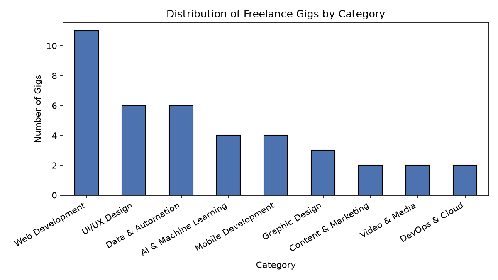
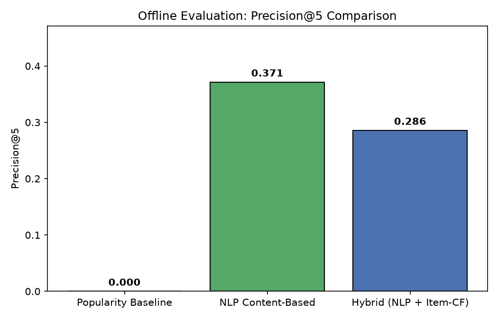

# Freelance Project and Client Gig Recommender (MP-C05)

- **Student Name:** Nguyễn Bá Anh Huy
- **Student ID:** 29211358655
- **Section:** CS467C (No. 05)
- **Project Title:** Freelance Project and Client Gig Recommender

## 1. Problem Statement
Freelancers spend significant time manually filtering client project briefs to find gigs matching their skills. This project builds a Python recommendation system that combines Natural Language Processing (TF-IDF) on project briefs/skills with Item-Based Collaborative Filtering over past gig ratings.

## 2. Dataset Description
- `data/items.csv`: 40 freelance gigs (`item_id`, `gig_title`, `category`, `budget_tier`, `project_brief`, `required_skills`).
- `data/ratings.csv`: 70 ratings across 14 freelancers (`user_id`, `item_id`, `rating` [1–5], `freelancer_note`), with 5 ratings per user (~87.5% sparsity).

## 3. NLP and Recommendation Methods
- **NLP Pipeline (`src/nlp_pipeline.py`):** Lowercasing, punctuation removal, custom stop-word removal, TF-IDF vectorization (unigrams + bigrams), and keyword overlap extraction.
- **Popularity Baseline:** Bayesian weighted average rating with a minimum rating count threshold, filtering out already-rated gigs.
- **NLP Content-Based Recommender:** Cosine similarity over TF-IDF vectors for both free-text freelancer bios and user rating profiles.
- **Hybrid Extension (`src/recommender.py`):** Blends NLP Content-Based similarity (60%) with Item-Based Collaborative Filtering rating predictions (40%).

## 4. Installation and Run Commands
```bash
pip install -r requirements.txt
python src/generate_data.py
python -m src.evaluate
python -m src.main
```

## 5. Sample Outputs (3 Required Test Cases)
Full outputs are saved in `results/sample_outputs.txt`.
1. **Profile Match:** Input `'React frontend, responsive UI, REST API integration'` returns React/Frontend gigs (`G01`, `G37`, `G04`, `G31`, `G19`) with matched keywords.
2. **History Test:** User `U01` (rated Mobile UI Design 5/5) receives Mobile UI / Figma recommendations (`G29`, `G20`, `G38`).
3. **Cold-Start Test:** Adding new gig `G41` (0 ratings) ranks it #1 immediately via NLP content matching (Score: `0.6582`).

## 6. Evaluation Results and Charts

## 6. Evaluation Results and Charts

- **Item-CF Rating Prediction:** RMSE = `1.1461`, MAE = `0.8929`

| Method | Precision@5 |
| :--- | :---: |
| Popularity Baseline | 0.0000 |
| NLP Content-Based | 0.3714 |
| Hybrid (NLP + Item-CF) | 0.2857 |




## 7. Short Reflection
- **What worked well:** TF-IDF unigrams + bigrams accurately matched domain-specific skills (e.g., `mobile ui`, `rest api`) and handled cold-start gigs effectively.
- **Limitations:** TF-IDF relies on exact lexical overlap and does not capture synonyms (e.g., "JS" vs "JavaScript"). Future work could replace TF-IDF with